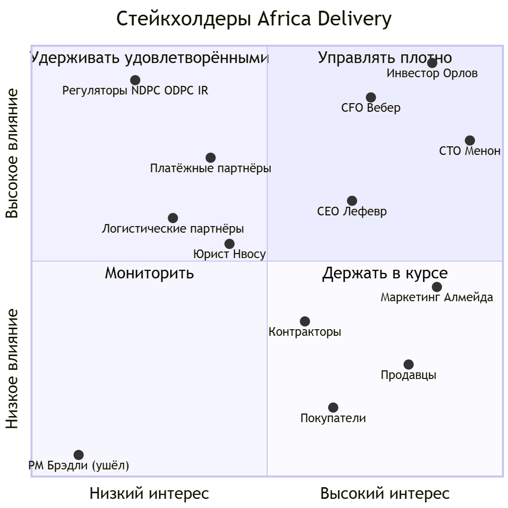

# Матрица стейкхолдеров Africa Delivery

**Версия:** 1.0
**Автор:** Solution Architect

Источники: 
- А1 - транскрипт кик-оффа
- А2 - маркетинговый бриф
- А3 - юридическое письмо
- А4 - список функций PM
- А5 - письмо CTO
- А6 - письмо CFO
- А7 - записка инвестора.

---

## 1. Правило приоритета

Чей голос решает при конфликте, сверху вниз:

1. **Закон** - требования регуляторов не торгуются и стоят выше любого стейкхолдера.
2. **Инвестор** - единственный акционер и финальный арбитр по срокам, скоупу и риску (А1, А7).
3. **CFO** - вето на бюджет. Делегировано инвестором: «с Анной не спорь» (А1).
4. **CTO** - технологии, но в рамках бюджета и команды (А1, А6).
5. **CEO** - скоуп релиза и продукт, PM нет (А1, А4).
6. **Маркетинг** - обещания креатива фиксированы, но это внешнее ограничение, а не требование к архитектуре (А2).

Конфликт CTO и CFO решается в пользу CFO: «если архитектура требует больше людей, чем у нас есть, неверна архитектура» (А6).

---

## 2. Матрица

| # | Стейкхолдер | Интересы | Влияние | Приоритет в конфликте | Коммуникация |
|---|---|---|---|---|---|
| 1 | **К. Орлов** - инвестор, единственный акционер | • Запуск 15.10 без переноса  • «Не падает», 1 мин = $12k  • Данные нигерийцев в стране, без вопросов министра  • Выплаты продавцам в тот же день  • Максимально дёшево  (А1, А7) | Высокое. Финансирует проект, связи в госструктурах, отменяет решения любого участника | 1 среди людей. Арбитр конфликтов срок/бюджет/риск | • Одна страница на английском, письменно (А1)  • Решение с ценой и альтернативой, а не проблема  • Выносить только то, что не решают CFO и CTO |
| 2 | **А. Вебер** - CFO | • Компания жива на 7-м месяце, runway 9 мес  • Инфраструктура до $5k/мес, без предоплат  • Платежи до 2,5% GMV  • Без лицензионного ПО  (А6) | Высокое. Подписывает каждую позицию от $500, вето делегировано инвестором | 2. Бюджет - жёсткая рамка для всех технических решений | • TCO на 5 лет с ФОТ, стоимость заказа, стоимость ошибки (А6)  • Письменное согласование с КП и альтернативой  • До Найроби, не после |
| 3 | **Р. Менон** - CTO | • Не упасть в ночь запуска  • Cloud Native, Kubernetes, Kafka, Istio  • Go и Oracle  • Build, not buy для логистики и платежей  (А5) | Высокое. Технологии - его зона (А1), прямой руководитель архитектора. Может заблокировать проект изнутри | 3. Решает технологии внутри рамок CFO и закона | • Черновики ADR до Найроби, согласованная позиция на встрече (А5)  • Спор только на цифрах: стоимость, люди, срок  • Сделать владельцем целевой архитектуры и критериев перехода к ней |
| 4 | **М. Лефевр** - CEO | • Чёткая граница первого релиза (А1)  • Опыт Jumia: такой запуск занимал год | Среднее. Формально руководитель, но нанят 6 недель назад и уступает инвестору | 4. Владелец скоупа MVP вместо ушедшего PM | • Еженедельный скоуп-ревью  • Союзник при сокращении 29 функций |
| 5 | **Регуляторы** - NDPC (NG), ODPC (KE), Information Regulator (ZA) | • Локализация ПДн Нигерии  • Подтверждаемое согласие в ЮАР  • Регистрация, DPO, аудит  (А3) | Высокое. Санкции, блокировка деятельности | Вне ранга. Закон, не предмет торга | • Только через юриста и инвестора  • Ранний контакт с NDPC (А3) |
| 6 | **Платёжные партнёры** - M-Pesa, Flutterwave, Paystack | • Объём транзакций  • Соблюдение их правил и KYC | Высокое. Без лицензии оплата возможна только через них (А3) | Внешнее ограничение. Их SLA, комиссии и сроки расчётов принимаются как данность | • Техническая интеграция и коммерческие условия через CFO |
| 7 | **Логистические партнёры** - Sendbox (NG), Sendy (KE) | • Объём отправлений | Среднее. Обещание «день в день» (А2) зависит от них | Внешнее ограничение | • API-интеграция, SLA в договоре |
| 8 | **А. Нвосу** - внешний юрист, Лагос | • Минимизация собственной ответственности (А3)  • Почасовая оплата | Среднее. Совещательный голос, но её заключение может изменить размещение данных | Ниже закона, выше маркетинга. Даёт трактовку закона | • Узкие письменные вопросы с дедлайном  • Без открытых запросов: оплата по часам |
| 9 | **С. Алмейда** - Head of Marketing | • Выполнить обещания креатива  • Сторы к 1.10, SMS по базе 410k, live-стрим 50k  (А2) | Среднее. $180k невозвратного бюджета, но решений по архитектуре не принимает | 6. Обещания учитываются как ограничения, но уступают закону и бюджету | • Таблица обещаний: выполняем / частично / нет  • Срок - до публикации в сторах 1.10 |
| 10 | **6 контракторов** | • Выполнимый объём  • Посильное дежурство | Среднее. Определяют реальную ёмкость: найм заморожен до декабря (А6) | Ограничение ёмкости. Архитектура подгоняется под команду | • Технические созвоны, ADR, runbook |
| 11 | **Продавцы** - малый и средний бизнес | • Деньги сегодня, а не через 30 дней (А1)  • Онбординг без сложностей, через WhatsApp и USSD (А4) | Низкое сейчас. Высокое для выручки | Через CEO | • Интервью 10-15 продавцов в Лагосе, если инвестор разрешит (А1) |
| 12 | **Покупатели** - город и село | • Доверие, нет подделок  • Экономия трафика на 3G  • USSD и SMS без интернета  (А2) | Низкое прямое. Голос через CEO и маркетинг | Через CEO | • Метрики воронки, отзывы |
| 13 | **Т. Брэдли** - бывший PM | • Список 29 функций, всё P0 (А4) | Нет. Уволился 4.08 | Не участвует. Список - вход, а не требование | • Не требуется |

---

## 3. Карта влияния и интереса

Исходник: [stakeholder-map.mmd](diagrams/stakeholder-map.mmd)

Тактика по квадрантам:

- **Управлять плотно** - инвестор, CFO, CTO, CEO. Работаем артефактами с цифрами: TCO, ADR, список сокращений. Конфликт CTO и CFO закрываем до Найроби, чтобы инвестор видел одну позицию.
- **Удерживать удовлетворёнными** - регуляторы, платёжные и логистические партнёры, юрист. Их условия входят в архитектуру как ограничения. Юристу - только узкие вопросы с дедлайном.
- **Держать в курсе** - маркетинг, контракторы, продавцы, покупатели. Маркетингу - статус по каждому обещанию. Контракторам - объём, который помещается в 8 недель.
- **Мониторить** - бывший PM. Только как источник списка функций.

---

## 4. Вывод

- Решающий голос - инвестор, но бюджетную рамку он сам отдал CFO. Технические решения CTO действуют только внутри этой рамки.
- Закон стоит выше всех: локализация данных Нигерии - и требование регулятора, и личный критерий успеха инвестора (А1, А7).
- Маркетинг влияет на сроки и ожидания, но не на выбор решения.
