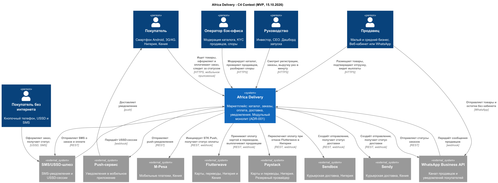
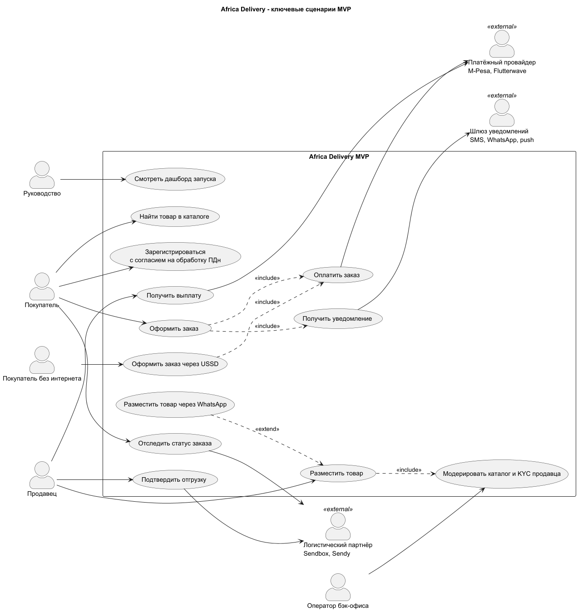

# Architecture Vision Africa Delivery

**Версия:** 1.0
**Дата:** 18.08.2026
**Автор:** Solution Architect
**Связано:** [ADR-001](adr-001-architecture-style.md), [сравнение вариантов](options-comparison.md), [TCO](tco-model.xlsx), [реестр противоречий](../Task1/contradictions.md), [Architecture Canvas](../Task1/architecture-canvas.md)

---

## 1. Проблема и цель

Маркетплейс с низкой ценой и ставкой на объём. Через 8 недель - работающий пилот в Нигерии и Кении при бюджете $5k/мес на облако и 6 контракторах. Через год - 5 стран и 1M+ пользователей, через 3 года - 12-15 стран.

Критерий успеха 16.10 (А1):
- Люди покупают.
- Продавцы получают деньги.
- Ничего не ломается.
- Нигерийские данные остаются в Нигерии.

## 2. Стейкхолдеры и что для них решает архитектура

| Стейкхолдер | Ключевое требование | Ответ архитектуры |
|---|---|---|
| Инвестор | Запуск 15.10, «не падает», данные в стране (А7) | MVP за 8 недель, SLO по сервисам, ПДн Нигерии у локального провайдера |
| CFO | $5k/мес, TCO с людьми, стоимость ошибки (А6) | $1 570/мес в Год 1, TCO 5 лет $5,0 млн по сравнимой части |
| CTO | Cloud Native, Go, масштаб (А5) | Go, контейнеры, GitOps, OpenTelemetry. Путь к сервисам по триггерам |
| CEO | Граница первого релиза (А1) | Скоуп по критерию: первая покупка, выплата продавцу, закон |
| Маркетинг | Сторы к 1.10, пики рекламы (А2) | Нагрузочный тест до 1.10, кеш каталога на CDN |

Полная матрица: [stakeholder-matrix.md](../Task1/stakeholder-matrix.md).

## 3. Архитектурные принципы

1. **Срок и бюджет - жёсткие рамки.** Решение, которое в них не помещается, неверно (А6).
2. **Partner и buy для всего, что не отличает продукт.** Платежи, доставка, SMS, WhatsApp, хостинг БД.
3. **Модульность сейчас, распределённость по триггеру.** Границы доменов закладываются сразу, сервисы выделяются, когда нагрузка это оправдает.
4. **Обратимость решений о данных.** Место хранения ПДн скрыто за отдельным модулем, оно меняется без переписывания остальных.
5. **Сбой партнёра не останавливает заказ.** Заказ принимается, внешние вызовы идут через очередь с повтором.
6. **Мобильный клиент на 3G.** Кеш контента в приложении, сжатые изображения, минимум запросов.

## 4. Целевое решение MVP

Контекст: [c4-context.puml](c4-context.puml)

- **Стиль:** модульный монолит на Go (ADR-001). Модули: каталог, заказы, платежи, доставка, уведомления, профили, кабинет продавца, аналитика.
- **Данные:** managed PostgreSQL, модуль владеет своими таблицами. ПДн нигерийцев в отдельном хранилище у локального провайдера, в основной БД только токены.
- **Интеграции:** адаптеры с единым контрактом для M-Pesa, Flutterwave, Paystack, Sendbox, Sendy, WhatsApp, SMS/USSD.
- **Каналы:** мобильное приложение, веб-кабинет продавца, WhatsApp для продавцов без кабинета, USSD и SMS для покупателей без интернета.
- **Доступность:** один регион + warm standby. SLO 99,9% в Год 1, повышение по мере роста GMV.

Сценарии MVP: [use-cases.puml](use-cases.puml)

## 5. Ключевые решения

| Решение | Противоречие | Обоснование |
|---|---|---|
| Модульный монолит вместо 40-50 микросервисов | C-01, C-03 | MVP за 8 недель силами 6 человек. V3 требует 16 человек и 6-9 месяцев |
| Managed-сервисы вместо self-hosted | C-02, C-03 | $1 570/мес против $9 130/мес, нет кластеров на дежурстве |
| PostgreSQL вместо Oracle | C-04 | Без лицензии $95k, переносим между провайдерами и on-prem |
| Партнёры для платежей и доставки | C-01, C-08 | Лицензия в срок нереалистична (А3), своя логистика - 6 месяцев (А5) |
| SLO по сервисам вместо 99,99% на всё | C-02, C-09 | 99,99% окупается при цене минуты выше $9,1k, реальная - $46 в Год 1 |
| ПДн Нигерии отдельно от ядра | C-05, C-06 | Ядро не зависит от трактовки NDPR, которую юрист даст через 4-6 недель |

## 6. Что не делаем и до какого момента

| Отложено | Условие возврата |
|---|---|
| Выделение сервисов, Kubernetes, Istio | Модулю нужно независимое масштабирование, больше 5 сервисов или команда больше 12 |
| Kafka | Managed-очередь не держит поток или нужен replay |
| Мультирегион active-active | Средний GMV в минуту × 3 выше $9k или Год 3 |
| Своя логистика и склад | Отдельный расчёт build против partner |
| Рассрочка, кошелёк, динамические цены, голосовой поиск | После MVP, по приоритету CEO |
| Блокчейн-лояльность | Исследование после 12 месяцев (А1, А5) |
| Финальное размещение данных | Заключение юриста (А3), решение в ADR-003 |

## 7. Переход к целевому состоянию

| Этап | Состояние |
|---|---|
| MVP, 15.10 | Модульный монолит, 1 регион + warm standby, NG и KE |
| 12 месяцев | 5 стран, кабинет продавца, track & trace, возвраты. Выделение нагруженных модулей: каталог и поиск, уведомления |
| 3 года | Сервисы по доменам, мультирегион, 99,99% для оплаты и заказов, 12-15 стран |

Выделение модуля в сервис не требует переписывания: модуль уже владеет своими данными и общается через события.

## 8. Риски

| Риск | Митигация |
|---|---|
| Пик на старте рекламы и стриме 17.10 (А2) | Нагрузочный тест до 1.10, CDN, автомасштабирование, флеш-распродажа с лимитом |
| Сбой партнёрского API | Очередь с повтором, резервный провайдер Paystack в Нигерии |
| Монолит теряет границы модулей | Проверка зависимостей в CI, запрет межмодульных JOIN |
| Заключение юриста расширит локализацию | Хранилище ПДн уже отдельное, перенос ядра в Нигерию без переписывания |
| CTO не принимает решение | Его целевая картина - состояние на 3 года с явными триггерами |

## Допущения

- Пилот: Нигерия и Кения, ЮАР после MVP.
- Расчётная нагрузка - объём пилота с запасом на пики, а не 10M пользователей (А5).
- Скоуп MVP сокращён CEO и подписан инвестором (C-10).
- Цифры стоимости - из [TCO](tco-model.xlsx), допущения модели в [options-comparison.md](options-comparison.md).
