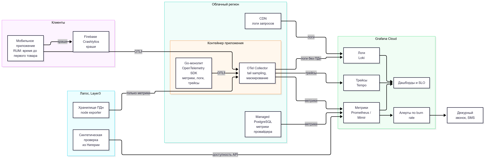

# Стратегия наблюдаемости

**Версия:** 1.0  
**Дата:** 25.08.2026  
**Связано:** 
- [реестр НФТ](nfr-registry.md)
- SLO [catalog](slo/catalog.md)
- [payments](slo/payments.md)
- [notifications](slo/notifications.md)
- [FMEA](fmea.md)

---

## 1. Цели

- Дежурный узнаёт об инциденте по расходу бюджета ошибок, а не от покупателей.
- По одному trace ID видно, где застрял заказ: у нас или у партнёра.
- Инвестор видит запуск на телефоне (А2).

## 2. Схема сбора

Исходник: [diagrams/observability-pipeline.mmd](diagrams/observability-pipeline.mmd)

## 3. Инструменты

| Задача | Инструмент | Почему |
|---|---|---|
| Инструментирование | OpenTelemetry SDK для Go | Стандарт CNCF, нет привязки к вендору (А5) |
| Сбор и обработка | OpenTelemetry Collector рядом с приложением | Tail sampling, удаление ПДн до отправки |
| Метрики | Prometheus-совместимое хранилище Grafana Cloud (Mimir) | Стек из письма CTO, но managed (А5, ADR-001) |
| Логи | Loki | Там же |
| Трейсы | Tempo, принимает формат Jaeger | Там же |
| Дашборды, SLO, алерты | Grafana | Один интерфейс для всех сигналов |
| Мобильный клиент | RUM-события через OTLP, краши в Firebase Crashlytics | Бесплатно, время до первого товара (NFR-05) |
| Синтетика | Проверка API с ВМ в Лагосе раз в минуту | Взгляд пользователя из Нигерии без новой строки в бюджете |

Стоимость - строка «Managed Grafana + OpenTelemetry» в [TCO](../Task2/tco-model.xlsx), $150/мес. Переход на self-hosted Prometheus, Loki и Jaeger возможен без изменения кода: приложение отдаёт данные по OTLP.

## 4. Четыре золотых сигнала

| Модуль | Задержка | Трафик | Ошибки | Насыщение |
|---|---|---|---|---|
| Каталог | • P95, P99 origin  • Время до первого товара (RUM) | • rps  • Доля CDN | Доля 5xx и ответов дольше 3 с | • CPU инстансов  • Пул соединений к БД |
| Заказ и оплата | • P99 создания заказа  • Время вебхук → «оплачен» | Заказов в минуту по стране и способу оплаты | • Доля 5xx  • Доля ошибок по каждому партнёру | • Глубина очереди платежей  • Состояние Circuit Breaker |
| Уведомления | Время событие → провайдер | Сообщений в минуту по каналу | • Ошибки провайдеров  • Доля без доставки | Глубина очередей транзакционных и маркетинговых |
| Адаптеры партнёров | P99 вызова | Вызовов в минуту | Доля 5xx и таймаутов | Открытые Circuit Breaker, повторы |
| PostgreSQL | Время запроса | Запросов в секунду | Deadlock, ошибки соединения | • CPU, IOPS, соединения  • Лаг реплики |
| Хранилище ПДн, Лагос | P99 ответа | Запросов в минуту | Ошибки и таймауты | CPU, диск, лаг репликации |

## 5. Метрики, логи, трейсы

| Сигнал | Правила |
|---|---|
| Метрики | • RED по каждому маршруту и адаптеру: запросы, ошибки, длительность  • Бизнес-метрики: заказы, оплаты, выплаты в минуту  • Метки: модуль, маршрут, страна, партнёр. Без ID пользователя |
| Логи | • JSON с trace ID  • Без ПДн: Collector маскирует телефоны и адреса  • Логи хранилища в Лагосе остаются в Нигерии, наружу уходят только метрики (NFR-17)  • Хранение 14 дней |
| Трейсы | • Сквозной trace от приложения через монолит к партнёру и обратно через вебхук  • 100% ошибок и медленных запросов, 10% остальных |

## 6. Связь метрик с SLI

| SLI | Метрика | Алерт |
|---|---|---|
| Доступность каталога | `catalog_requests_total` по коду и признаку `slow` | Burn rate |
| Время до первого товара | `rum_first_product_seconds` по типу сети | Тикет, если P90 выше цели сутки |
| Приём заказа | `http_requests_total{route=~"/orders\|/payments"}` | Burn rate |
| Обработка вебхука | `webhook_to_paid_seconds` | Burn rate |
| Корректность оплаты | `reconciliation_mismatches` | Page на любое значение > 0 после сверки |
| Передача уведомления | `notification_handoff_seconds` | Burn rate |
| Согласие | `marketing_sent_without_consent_total` | Page на любое значение > 0 |

**Алерты по расходу бюджета ошибок:**

| Скорость расхода | Окна | Расход бюджета | Действие |
|---|---|---|---|
| 14,4x | 1 ч и 5 мин | 2% | Page дежурному |
| 6x | 6 ч и 30 мин | 5% | Page дежурному |
| 1x | 3 дня и 6 ч | 10% | Тикет в рабочее время |

## 7. Дашборды

| Дашборд | Для кого | Содержание |
|---|---|---|
| Запуск | Инвестор, CEO | Регистрации, заказы, выручка, обновление раз в минуту (А2). Читает реплику БД |
| SLO | Дежурный, CTO | Бюджет ошибок по трём сервисам, burn rate |
| Партнёры | Дежурный | Ошибки, задержки, Circuit Breaker по M-Pesa, Flutterwave, Paystack, Sendbox, Sendy, SMS, WhatsApp |
| Инфраструктура | DevOps | Насыщение инстансов, БД, очередей, хранилища в Лагосе |

## Допущения

- Объём телеметрии MVP укладывается в тариф Grafana Cloud за $150/мес при сэмплировании трейсов 10%.
- ВМ в Лагосе уже есть в TCO под хранилище ПДн, синтетическая проверка работает на ней.
