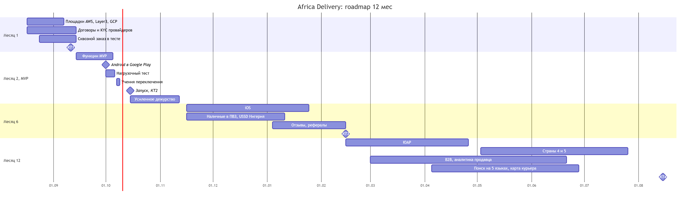

# Roadmap

**Версия:** 0.1  
**Дата:** 31.08.2026  
**Автор:** Solution Architect  
**Связано:** 
- [переходная архитектура](transition-architecture.md)
- [команда](team-structure.md) 
- [ADR-004](adr-004-payment-provider.md) 
- [TCO](../Task2/tco-model.xlsx) 
- C-03, C-10

---

## 1. Критерий отбора в MVP

Функция входит в MVP, если без неё нельзя:
- **П** - совершить первую покупку
- **В** - выплатить продавцу
- **З** - выполнить закон
- **Ц** - выполнить прямо названное в целях пилота (ЦБ)

Остальное получает дату или не планируется.

## 2. Список PM (А4): что вошло

Полностью не вошла ни одна из 29:  
- в урезанном виде -- 13
- на 6 мес -- 3
- на 12 мес -- 4  
- не планируется -- 9

| № | Функция | Решение | Критерий или причина |
|---|---|---|---|
| 1 | Каталог без ограничений на категории и атрибуты | **MVP**: фиксированный набор категорий и атрибутов | П |
| 2 | Поиск с опечатками на 5 языках | **MVP**: английский, PostgreSQL  5 языков - 12 мес | П |
| 8 | Онбординг продавца через WhatsApp | **MVP**: товары через WhatsApp, KYC проверяет оператор | П: без товара нет покупки |
| 10 | Кабинет продавца с аналитикой | **MVP**: товары, заказы, выплаты  Аналитика - 12 мес | В |
| 11 | Все способы оплаты | **MVP**: M-Pesa, карта, перевод ([ADR-004](adr-004-payment-provider.md))  Наличные - 6 мес | П, Ц |
| 16 | Флеш-распродажи | **MVP**: цена по времени и резерв остатка | П: резерв не даёт продать то, чего нет |
| 18 | Трекинг с картой курьера и ETA | **MVP**: статусы партнёра в SMS  Карта - 12 мес | Ц: уведомления |
| 19 | ПВЗ с видеозаписью | **MVP**: ПВЗ партнёра без видео | Законность видео не проверена (А4) |
| 20 | Возврат 30 дней с мгновенным возвратом денег | **MVP**: возврат через оператора, деньги после приёмки | З, C-08 |
| 24 | Офлайн-заказ USSD и SMS | **MVP**: USSD в Кении с M-Pesa  Нигерия - 6 мес | П для кнопочных телефонов |
| 25 | PWA, iOS, Android с паритетом | **MVP**: Android и мобильный веб  iOS - 6 мес | П: Android у большинства покупателей |
| 26 | Бэк-офис | **MVP**: модерация, KYC, возвраты, ручная выплата | З, В |
| 28 | Дашборд руководителя | **MVP**: дашборд запуска, обновление раз в минуту | Ц |
| 7 | Отзывы с фото и видео | 6 мес: текст и фото | Не П, В, З, Ц |
| 23 | Партнёрская и реферальная программа | 6 мес | Не П, В, З, Ц |
| 29 | Тёмная тема | 6 мес | Не П, В, З, Ц |
| 4 | AI-рекомендации | 12 мес: похожие товары по правилам | Нет данных для модели |
| 6 | Чат покупателя и продавца с переводом | 12 мес: без перевода | Модерация чата требует людей |
| 21 | ML-антифрод | 12 мес: правила по данным  В MVP - инструменты провайдера | Нет данных для модели |
| 22 | B2B | 12 мес | ЦБ на 12 мес |
| 3 | Голосовой поиск на суахили и хауса | Не планируется | Нет данных и команды |
| 5 | Live-стрим с чатом | Не планируется. Стрим 17.10 на внешней площадке со ссылками на товары | Внешняя площадка держит 50k зрителей бесплатно |
| 9 | Онбординг продавца через USSD | Не планируется | WhatsApp и веб покрывают продавцов |
| 12 | BNPL со своим скорингом | Не планируется | Лицензия, кредитный риск |
| 13 | Мультивалютный кошелёк с P2P | Не планируется | Лицензия (А3) |
| 14 | Крипто-лояльность | Не планируется | Лицензия, «не к октябрю» (А1) |
| 15 | Колесо фортуны | Не планируется | Не влияет на цели пилота |
| 17 | Цены из скрапинга Jumia | Не планируется | Юридический риск скрапинга |
| 27 | Публичный GraphQL API | Не планируется | Нет внешних потребителей |

## 3. Контрольные точки

| | Месяц 1 11.09.2026 | Месяц 2, MVP 15.10.2026 | Месяц 6 15.02.2027 | Месяц 12 15.08.2027 |
|---|---|---|---|---|
| **Объём** | • 3 площадки: AWS Кейптаун, Layer3 Лагос, GCP Йоханнесбург  • Договоры и KYC с провайдерами  • Сквозной заказ в тестовой среде | • 13 функций в урезанном виде  • Нигерия и Кения  • 100 продавцов, 5000 SKU | • iOS, наличные в ПВЗ, USSD в Нигерии  • Отзывы, реферальная программа  • Подготовка ЮАР | • 5 стран  • B2B, аналитика продавца, карта курьера  • Поиск на 5 языках  • Расчёт своей логистики ([capability map](capability-map.md)) |
| **Команда** | 6 контракторов | 6 контракторов | 8: +iOS, +QA после снятия заморозки в декабре | 10: +backend, +аналитик данных |
| **Инфраструктура** | ~\$500/мес, тестовая среда | ~\$1 620/мес | ~\$2 000/мес | ~\$3 400/мес |

**Откуда цифры инфраструктуры:**
- На запуске \$1 620/мес: \$1 570 из TCO для выбранного варианта и ~\$50 на хранение данных в Нигерии из ADR-003.
- К месяцу 12 растёт число пользователей, поэтому берём расходы Года 2 из TCO.
- Во всех точках расходы ниже лимита CFO \$5k/мес (А6).

**Команда сверх бюджета:** в TCO заложены только 6 контракторов. Каждые 2 новых человека стоят \$120k в год. Наём в месяц 6 и месяц 12 нужно согласовать с CFO.

## 4. План

Исходник: [roadmap-gantt.mmd](roadmap.mmd)

## Допущения

- Даты от старта проекта 12.08.2026.
- Android - основная платформа покупателей в Нигерии и Кении. iOS в магазине к 1.10 (А2) не обещаем.
- Страны 4 и 5 не названы (ADR-004: Гана, Уганда).
